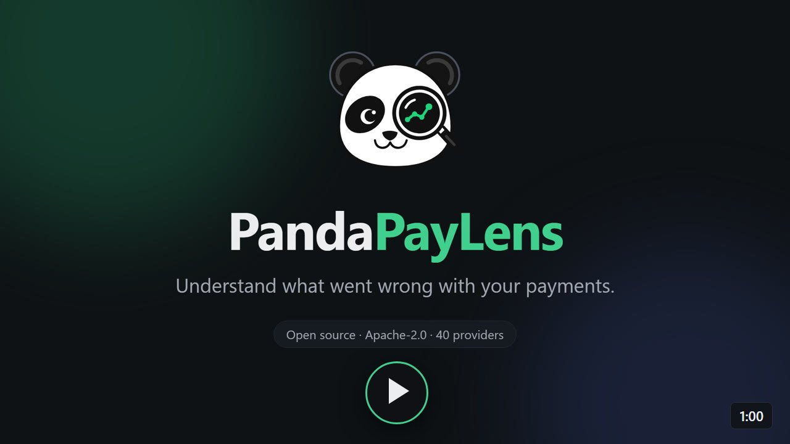
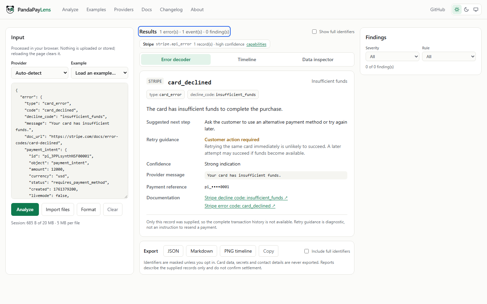
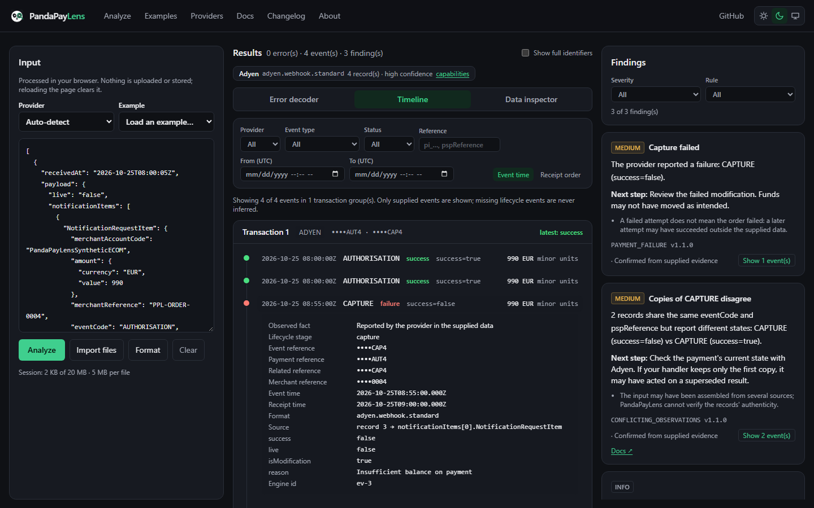

<p align="center"></p>

<h1 align="center">PandaPayLens</h1>

<p align="center">
Decode payment errors. Visualize transaction events. Understand what went wrong.<br>
A source-available, local-first toolkit for debugging payment integrations across supported providers.
</p>

<p align="center">
<a href="https://ratomirjovanovic.github.io/PandaPayLens/"><b>Live demo</b></a> ·
<a href="https://ratomirjovanovic.github.io/PandaPayLens/media/pandapaylens-demo.mp4">Demo video (1 min)</a> ·
<a href="https://ratomirjovanovic.github.io/PandaPayLens/docs/">Documentation</a> ·
<a href="https://github.com/ratomirjovanovic/PandaPayLens/issues/new?template=bug_report.md">Report a bug</a>
</p>

<p align="center"><a href="https://ratomirjovanovic.github.io/PandaPayLens/media/pandapaylens-demo.mp4"></a></p>

Paste a payment error, webhook or event log from a supported provider. PandaPayLens detects the provider and format, explains the error, rebuilds the transaction timeline and points out duplicate deliveries, out-of-order events, conflicting states and possible retry risks. Everything runs in your browser.

<p align="center"></p>

## Features

- **Error decoder:** provider error, decline and refusal codes with an explanation, the next step, retry guidance, a confidence level and a link to the provider's documentation.
- **Transaction timeline:** events grouped by explicit identifiers, ordered by event time or receipt order, with filters. Missing events are never invented.
- **Deterministic findings:** explainable rules with evidence, confidence and limitations. No AI in the diagnostic path.
- **Many input formats:** JSON, JSON Lines, URL-encoded notifications and raw HTTP requests or responses copied from logs.
- **Privacy by design:** analysis in a Web Worker, a Content Security Policy that blocks requests to other origins, nothing stored, sensitive fields hidden.
- **Exports:** JSON and Markdown reports and a PNG timeline, with identifiers masked by default.
- **CLI and library:** the same engine runs offline in Node.js.

<p align="center"></p>

## Provider coverage

<!-- providers:start -->

40 of 42 roadmap providers can be analyzed today. "Supported" means implemented and covered by tests; "limited" means it works with documented gaps. Research candidates and planned providers are listed on the [providers page](https://ratomirjovanovic.github.io/PandaPayLens/providers/) and are not counted here.

| Provider       | Overall   | Errors    | API responses | Webhooks     | Timeline     | Correlation |
| -------------- | --------- | --------- | ------------- | ------------ | ------------ | ----------- |
| Stripe         | supported | supported | supported     | supported    | supported    | supported   |
| Adyen          | supported | supported | supported     | supported    | supported    | supported   |
| payabl.        | limited   | supported | supported     | limited      | limited      | limited     |
| Checkout.com   | limited   | supported | supported     | limited      | limited      | supported   |
| Braintree      | limited   | supported | supported     | limited      | limited      | limited     |
| PayPal         | limited   | supported | supported     | limited      | limited      | limited     |
| Mollie         | limited   | limited   | supported     | limited      | limited      | supported   |
| Square         | limited   | supported | supported     | supported    | limited      | limited     |
| Flutterwave    | limited   | limited   | supported     | limited      | limited      | limited     |
| Paystack       | limited   | limited   | supported     | limited      | limited      | limited     |
| Razorpay       | limited   | supported | supported     | supported    | limited      | supported   |
| PayU India     | limited   | supported | limited       | limited      | limited      | limited     |
| BlueSnap       | limited   | supported | limited       | limited      | limited      | limited     |
| EBANX          | limited   | supported | supported     | limited      | limited      | supported   |
| dLocal         | limited   | limited   | supported     | limited      | limited      | supported   |
| Rapyd          | limited   | supported | limited       | limited      | limited      | limited     |
| Airwallex      | limited   | supported | limited       | limited      | limited      | supported   |
| Paysafe        | limited   | supported | limited       | limited      | limited      | limited     |
| Nuvei          | limited   | supported | limited       | limited      | limited      | limited     |
| Authorize.net  | limited   | supported | limited       | limited      | limited      | limited     |
| Cybersource    | limited   | supported | supported     | limited      | limited      | limited     |
| Worldpay       | limited   | supported | supported     | limited      | limited      | limited     |
| Trustly        | limited   | limited   | limited       | limited      | limited      | limited     |
| DECTA          | limited   | supported | limited       | limited      | limited      | limited     |
| Inpay          | limited   | limited   | limited       | limited      | limited      | supported   |
| Finrax         | limited   | limited   | limited       | limited      | limited      | supported   |
| AstroPay       | limited   | limited   | supported     | limited      | limited      | limited     |
| eZeeWallet     | limited   | limited   | limited       | limited      | experimental | limited     |
| Skrill         | limited   | supported | limited       | limited      | limited      | limited     |
| MiFinity       | limited   | limited   | limited       | limited      | limited      | limited     |
| NMI            | limited   | supported | supported     | limited      | limited      | limited     |
| Paymentwall    | limited   | limited   | limited       | supported    | limited      | limited     |
| Ecommpay       | limited   | supported | supported     | limited      | limited      | supported   |
| emerchantpay   | limited   | supported | limited       | limited      | limited      | limited     |
| CCBill         | limited   | limited   | limited       | limited      | limited      | limited     |
| Segpay         | limited   | limited   | unsupported   | limited      | limited      | supported   |
| Trust Payments | limited   | supported | supported     | limited      | limited      | supported   |
| PXP Financial  | limited   | supported | supported     | limited      | limited      | limited     |
| Verotel        | limited   | limited   | limited       | limited      | limited      | supported   |
| NETbilling     | limited   | limited   | supported     | experimental | limited      | limited     |

<!-- providers:end -->

Adapters are built from each provider's official documentation; research notes are in [`docs/providers/research`](docs/providers/research). PandaPayLens is not affiliated with any of these providers.

## Quick start

Requires Node.js 22+ and pnpm 10. No database, account or API key is needed.

```bash
git clone https://github.com/ratomirjovanovic/PandaPayLens.git
cd PandaPayLens
pnpm install
pnpm dev:pages        # static analyzer at http://localhost:3200/PandaPayLens/
```

`pnpm dev` runs the full Next.js application (Vercel target) at http://localhost:3000. Its admin area stays disabled unless configured; see [docs/deployment.md](docs/deployment.md).

## CLI

```bash
npx pandapaylens analyze events.json
npx pandapaylens decode - < error.json
npx pandapaylens analyze events.jsonl --format markdown
npx pandapaylens analyze log.json --fail-on medium
npx pandapaylens providers --supported
npx pandapaylens examples
```

The [`pandapaylens`](https://www.npmjs.com/package/pandapaylens) package also works as a library (`import { analyze } from "pandapaylens"`), with TypeScript types and no runtime dependencies. From a clone, run `pnpm build:packages` and use `node packages/cli/dist/bin.js` instead of `npx pandapaylens`.

Exit codes: `0` ok, `1` findings at or above `--fail-on`, `2` invalid input, `3` unsupported provider or format, `4` internal error. A declined payment does not fail the run unless you ask for it.

## Privacy model

- Imported payloads are processed only in the browser and never sent to a server, analytics or logs.
- The Content Security Policy allows requests only to the site itself (`connect-src 'self'`).
- Nothing is written to cookies, localStorage, sessionStorage or IndexedDB; reloading clears the workspace.
- Card data, secrets, contact details and bank details are hidden and never exported. Redaction is best effort and does not guarantee anonymization.
- Pasted webhooks are never treated as verified, and no report confirms settlement.
- Playwright tests plant unique marker values in the input and check that none appear in any network request or in browser storage, on both the Vercel app and the GitHub Pages build.

See [SECURITY.md](SECURITY.md) to report a vulnerability. PandaPayLens is not PCI DSS certified and has not had an independent penetration test.

## Architecture

```text
packages/core              parsing (JSON, JSONL, form, HTTP), detection, normalization,
                           correlation, rules engine, redaction, reports
packages/adapters/*        one package per provider: schemas, catalogs, normalization
packages/providers         adapter registry, capability manifests, roadmap
packages/rules             versioned diagnostic rule catalog
packages/cli               offline command-line interface
apps/web                   Next.js application for Vercel (analyzer, docs, admin)
apps/pages                 static export of the same pages for GitHub Pages
fixtures                   synthetic test data (no real payment data)
```

The core package has no dependency on React, Next.js, a database or the network. Both apps use the same pages, components and analysis engine; the GitHub Pages build excludes the admin area and all server code.

## Documentation

- [Getting started](https://ratomirjovanovic.github.io/PandaPayLens/docs/)
- [Security and privacy](https://ratomirjovanovic.github.io/PandaPayLens/docs/security/)
- [Providers](https://ratomirjovanovic.github.io/PandaPayLens/providers/)
- [Deployment and self-hosting](docs/deployment.md)
- [Adding a provider](docs/contributing/add-provider.md)
- [Wiki](https://github.com/ratomirjovanovic/PandaPayLens/wiki): how analysis works, input formats, rules and the CLI

## Contributing

Contributions are welcome: provider adapters, error catalog entries, synthetic fixtures, accessibility and documentation. Read [CONTRIBUTING.md](CONTRIBUTING.md). Working on the analyzer never requires Vercel, Neon or admin access.

```bash
pnpm test             # unit, property-based, provider and scenario tests
pnpm typecheck
pnpm build:pages      # static demo, verified after build
pnpm test:e2e         # Playwright against the full app (after pnpm build)
```

## Roadmap

Released: the analyzer, CLI and demo (0.1.0), high-risk waves HR-1 (0.2.0), HR-2 (0.3.0) and HR-3 (0.4.0), the wave 2 gateways Worldpay, Cybersource, Authorize.net and Nuvei (0.6.0), Paysafe, Airwallex, Rapyd, dLocal and EBANX (0.7.0), BlueSnap, PayU India, Razorpay, Paystack and Flutterwave (0.8.0), repeat detection without delivery ids (0.10.0), XML input (0.11.0), Worldpay XML (0.12.0), plain `name: value` text (0.13.0) and the npm package (0.14.0).

See [ROADMAP.md](ROADMAP.md) for details.

## License

PandaPayLens is source available under the [Elastic License 2.0](LICENSE) (ELv2). It is free to use: you can run it, change it and share it, also inside your company and on client projects.

You need permission from the maintainer to offer PandaPayLens to others as a hosted or managed service, or to use it under terms other than ELv2. For a commercial licence, contact [Ratomir Jovanovic](https://github.com/ratomirjovanovic).

Releases up to and including 0.14.0 were published under the Apache License 2.0 and stay available under it.

## Maintainer

[Ratomir Jovanovic](https://github.com/ratomirjovanovic)
